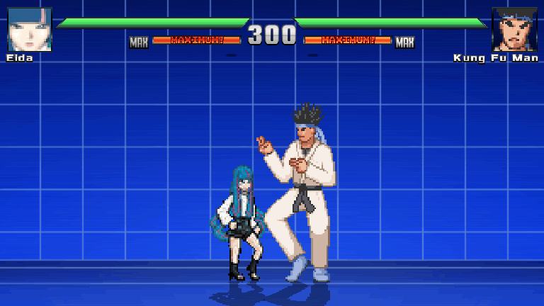
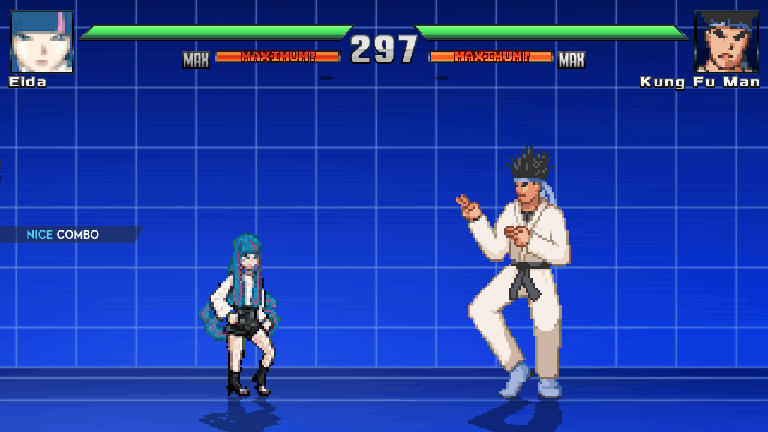

# Eida para Jump Force MUGEN V14

[Descargar Eida: revisión del video](https://github.com/codeuzumaki6/MUGEN/raw/refs/heads/main/Eida_REVISION_VIDEO.zip)

[Controles físicos de Xbox](Eida/CONTROLES_XBOX.md) · [Detalles y límites de las pruebas](Eida/LEEME.md)

Esta revisión corrige el segundo golpe de X que volteaba a Eida, enlaza X → Y → B en el aire con pulsaciones durante hitpause y muestra un corazón sobre el rival al confirmar Encantamiento. Habilita un dash con dos toques hacia delante que permite atacar o saltar. Todavía usa dibujos de caminata para ese desplazamiento: no contiene una nueva hoja de sprites ni reproduce todo el acabado del video.

Conserva las once técnicas, Daemon que aparece junto a Eida y corre hasta el alcance, despertar con el cuerpo normal y aura azul, y Omnipotencia en A de Xbox. El [análisis de la referencia](previews/ANALISIS_VIDEO_EIDA.md) distingue lo observado en el MP4 de las funciones implementadas.

## Capturas del motor

Estas animaciones se capturaron en Ikemen GO; el escenario y las barras de Jump Force MUGEN V14 son diferentes.





[Dash actual](previews/Eida_dash_motor.gif) · [Daemon junto a Eida](previews/Daemon_desde_Eida_motor.gif) · [Aura del despertar](previews/Eida_aura_azul_motor.gif)

## Desarrollo

Trabaja en el checkout existente. Requisitos: Python 3 con Pillow, ffmpeg para convertir efectos de sonido y un motor Ikemen GO para pruebas compatibles; el binario exacto de Jump Force MUGEN V14 requiere pruebas locales del usuario.

```sh
python3 tools/build_moveset.py
python3 tools/build_archives.py
python3 tools/validate_character.py Eida
python3 tools/check_moves_in_engine.py /ruta/al/motor/ikemen
python3 tools/make_video_reference_previews.py /ruta/al/motor/ikemen
python3 tools/package_character.py
```

El ZIP contiene los archivos de ejecución y la guía de controles. Los recursos fuente están en `Eida/assets/`. Los generadores conservan los ejes de los efectos de la referencia original; la coloración azul y la transparencia aditiva se aplican en el motor. No se necesitan procesos de servidor para editar el personaje.

El informe [engine_moveset_checks.json](previews/engine_moveset_checks.json) registra 47 escenarios con entradas y colisiones reales del motor. Las pruebas modifican únicamente copias temporales y restauran el script de diagnóstico del motor al terminar. Los archivos entregados son CNS/CMD/AIR para MUGEN 1.1 y no incluyen los controladores exclusivos de la instrumentación de Ikemen. En este entorno, el motor oficial verificado está en `/workspace/.eida-tools/ikemen-nightly`; el comando de prueba recibe esa ruta.
