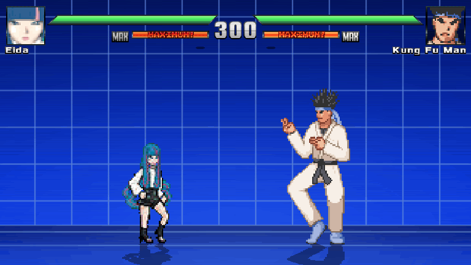
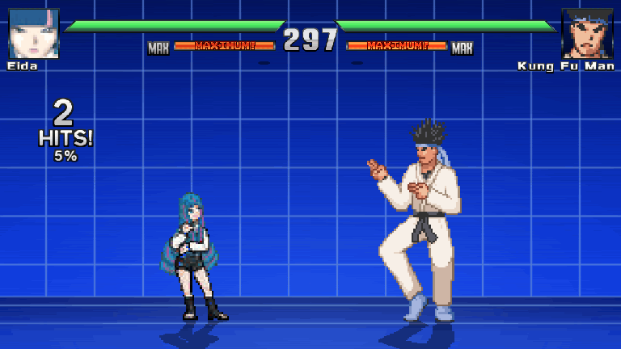

# Eida para Jump Force MUGEN V14

[Descargar la revisión con 11 jutsus](https://github.com/codeuzumaki6/MUGEN/raw/refs/heads/main/Eida_VERSUS_11_JUTSUS.zip)

[Controles físicos de Xbox](Eida/CONTROLES_XBOX.md) · [Detalles y límites de las pruebas](Eida/LEEME.md)

Esta revisión reduce a Daemon y hace que aparezca junto a Eida, recorra el escenario y ataque al entrar en alcance. El despertar mantiene los sprites normales y usa un efecto azul aditivo de 13 cuadros. Incluye nueve técnicas con abajo/diagonales + X/Y/B, parry en RB, asalto en RT y Omnipotencia en A.

## Capturas del motor

Estas animaciones se capturaron en Ikemen GO; el escenario y las barras de Jump Force MUGEN V14 son diferentes.





## Desarrollo

Trabaja en el checkout existente. Requisitos: Python 3 con Pillow, ffmpeg para convertir efectos de sonido y un motor Ikemen GO para pruebas compatibles; el binario exacto de Jump Force MUGEN V14 requiere pruebas locales del usuario.

```sh
python3 tools/build_moveset.py
python3 tools/build_archives.py
python3 tools/validate_character.py Eida
python3 tools/check_moves_in_engine.py /ruta/al/motor/ikemen
python3 tools/package_character.py
```

El ZIP contiene los archivos de ejecución y la guía de controles. Los recursos fuente están en `Eida/assets/`. Los generadores conservan los ejes de los efectos de la referencia original; la coloración azul y la transparencia aditiva se aplican en el motor. No se necesitan procesos de servidor para editar el personaje.

El informe [engine_moveset_checks.json](previews/engine_moveset_checks.json) registra 42 escenarios con entradas y colisiones reales del motor. Las pruebas modifican únicamente copias temporales y restauran el script de diagnóstico del motor al terminar. Los archivos entregados son CNS/CMD/AIR para MUGEN 1.1 y no incluyen los controladores exclusivos de la instrumentación de Ikemen.
