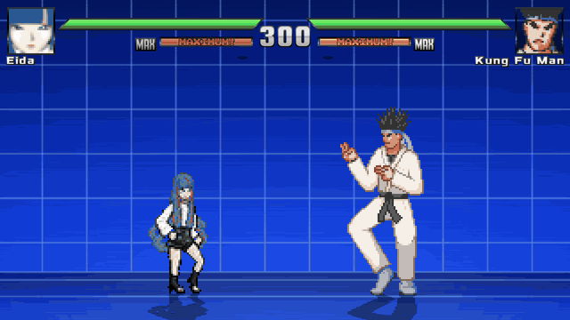

# Eida para Jump Force MUGEN V14

[Descargar Eida: corrección de Eida.cmd línea 304](https://github.com/codeuzumaki6/MUGEN/raw/refs/heads/main/Eida_FIX2_CMD304.zip)

La captura del usuario identificó `Error parsing trigger2` en `Eida.cmd:304`. Las diez condiciones de cancelación que mezclaban un intervalo sin agrupar y `||` ahora usan grupos de disparadores independientes para cada estado. Se mantiene la condición de golpe conectado. El validador detecta el error exacto del ZIP anterior y las tres pruebas de regresión verifican el archivo actual y ambos fallos conocidos. Sustituye la carpeta `chars/Eida` completa por la de este ZIP.

Corrección de carga: los fundidos de Omnipotencia usaban `Min()`, una extensión de Ikemen que MUGEN 1.1 no reconoce. Se sustituyó por `IfElse()` conservando el mismo cálculo. El validador ahora rechaza llamadas de expresiones ajenas a MUGEN 1.1; detecta el fallo en el ZIP anterior y acepta el corregido. Reemplaza la carpeta `chars/Eida` completa, incluido `Omnipotencia.cns`.

[Controles físicos de Xbox](Eida/CONTROLES_XBOX.md) · [Detalles y límites de las pruebas](Eida/LEEME.md)

Omnipotencia ahora empieza con un sello que viaja hasta el rival: se puede bloquear, saltar o dejar fuera de alcance. Al fallar consume las tres barras sin cinemática ni daño. Al conectar muestra seis encuadres originales del manga a 1280×720, con fundidos, cámara, sonido y remate de 350 de daño. Se eliminaron los paneles reducidos a 320×240.

Añade doble encanto (↓A), retroceso de Senrigan (↓RB) y apertura combinada con Daemon (↓RT), además de rutas X → Y → Y y X → B → B y cancelaciones ofensivas durante hitpause. El salto sube moderadamente. Los sprites de Daemon, el cuerpo normal de Eida y el aura del despertar se conservan. Todavía falta un ciclo dibujado de carrera: el dash reutiliza sus cuadros de caminata.

## Capturas del motor

Estas animaciones se capturaron en Ikemen GO; el escenario y las barras de Jump Force MUGEN V14 son diferentes.

[Ver Omnipotencia en MP4 720p con sonido](previews/Omnipotencia_motor_HD.mp4)



[Combo mixto](previews/Eida_combo_mixto_motor.gif) · [Apertura combinada](previews/Eida_apertura_combinada_motor.gif) · [Doble encanto](previews/Eida_doble_encanto_motor.gif) · [Paso de Senrigan](previews/Eida_paso_senrigan_motor.gif)

[Dash actual](previews/Eida_dash_motor.gif) · [Daemon junto a Eida](previews/Daemon_desde_Eida_motor.gif) · [Aura del despertar](previews/Eida_aura_azul_motor.gif)

## Desarrollo

Trabaja en el checkout existente. Requisitos: Python 3 con Pillow, ffmpeg para convertir efectos de sonido y un motor Ikemen GO para pruebas compatibles; el binario exacto de Jump Force MUGEN V14 requiere pruebas locales del usuario.

```sh
python3 tools/build_moveset.py
python3 tools/build_cinematic.py
python3 tools/build_archives.py
python3 tools/validate_character.py Eida
python3 tools/check_moves_in_engine.py /ruta/al/motor/ikemen
python3 tools/make_video_reference_previews.py /ruta/al/motor/ikemen
python3 tools/make_ultimate_preview.py /ruta/al/motor/ikemen
python3 tools/package_character.py
```

El ZIP contiene los archivos de ejecución y la guía de controles. Los recursos fuente están en `Eida/assets/`. Los generadores conservan los ejes de los efectos de la referencia original; la coloración azul y la transparencia aditiva se aplican en el motor. No se necesitan procesos de servidor para editar el personaje.

El informe [engine_moveset_checks.json](previews/engine_moveset_checks.json) registra 60 escenarios de movimiento, técnicas y combos. Las nueve pruebas adicionales de la ulti están en [engine_ultimate_checks.json](previews/engine_ultimate_checks.json): acierto, bloqueo, evasión, rival fuera de alcance en ambas orientaciones, y falta de energía. Para reproducirlas: `EIDA_ULTIMATE_CHECK=1 python3 tools/check_moves_in_engine.py /ruta/al/motor`.

Las pruebas modifican únicamente copias temporales y restauran el script de diagnóstico del motor al terminar. Los archivos entregados son CNS/CMD/AIR para MUGEN 1.1 y no incluyen instrumentación de Ikemen. No se ejecutó la versión exacta de Jump Force MUGEN V14 del usuario ni se probó físicamente su mando. El motor oficial verificado de este entorno está en `/workspace/.eida-tools/ikemen-nightly`; no requiere servidores. El MP4 usa capturas reales del motor con audio mezclado a partir de las muestras originales del SND y los tiempos de activación registrados. El arte del manga no fue redibujado con IA.
